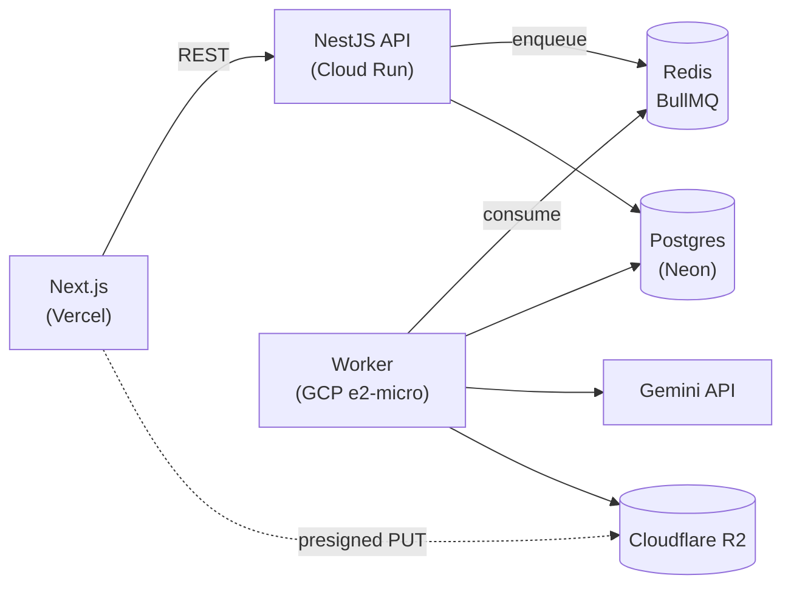

# Invoice

**An open source receipt and invoice inbox for freelancers.** Drop in receipts and invoices from any country; Gemini extracts vendor, dates, amounts and tax, uncertain fields go to a review queue, and clean data comes out as a dashboard and a CSV for your accountant.

[](https://github.com/TarekGuesri/invoice/actions/workflows/ci.yml)
[](https://github.com/TarekGuesri/invoice/actions/workflows/deploy.yml)
[](LICENSE)

**Hosted instance:** [invoice.tariqguesri.com](https://invoice.tariqguesri.com) · **API health:** [api.invoice.tariqguesri.com/api/v1/health](https://api.invoice.tariqguesri.com/api/v1/health)

> **Early development.** Invoice is not ready for real bookkeeping yet: only the foundation (Milestone 0) is in place so far. The hosted instance runs on the Gemini free tier, so don't upload real financial documents to it.

## Features

Planned for the first stable release:

- **Extraction that shows its work.** Gemini returns structured output that is validated field by field. Every value has a confidence score, and anything below the threshold goes to a review queue instead of your books.
- **Live pipeline status.** Each upload moves from queued to processing to done in real time. Rate limits, retries and duplicate files are handled, so nothing is lost or processed twice.
- **Ready for your accountant.** Spending by category and month, tax totals per currency, and a CSV export.
- **Your data stays yours.** Export or delete everything at any time, or run your own instance.

## Roadmap

Each milestone ships as a tagged release and is deployed to the hosted instance.

| Milestone                         | Scope                                                                                   |
| --------------------------------- | --------------------------------------------------------------------------------------- |
| **M0: Foundation** (in progress)  | Landing page, `GET /api/v1/health` (DB + Redis + worker heartbeat), CI/CD to production |
| M1: Auth                          | Register, log in, refresh, log out                                                      |
| M2: Extraction pipeline           | Upload → queue → Gemini → review rules                                                  |
| M3: Real-time + review            | Live status over WebSockets, review screen                                              |
| M4: Dashboard, export, GDPR, demo | Charts, CSV and data export, account deletion, a demo account with sample data          |

## Architecture



One NestJS codebase has two entrypoints in the same Docker image: `main.ts` serves HTTP on Cloud Run, and `worker.ts` runs BullMQ processors on a small always-on VM, because Cloud Run only gives a container CPU while it serves a request. The whole stack runs on free tiers. Design decisions are recorded as [ADRs](docs/adr).

## Development

Requires [Bun](https://bun.sh) 1.4+, Node.js 22+ and Docker.

```bash
bun install
docker compose up -d
cp apps/api/.env.example apps/api/.env && cp apps/web/.env.example apps/web/.env.local && cp packages/db/.env.example packages/db/.env
bun db:deploy
bun dev
```

- Web: http://localhost:3000
- API: http://localhost:4000/api/v1/health
- MinIO console: http://localhost:9001 (`minio` / `minio123`)

If ports 5432 or 6379 are taken, start compose with `POSTGRES_PORT=5433 REDIS_PORT=6380 docker compose up -d` and update the URLs in the `.env` files.

To run the production image locally (API on port 8080 plus the worker):

```bash
docker compose --profile app up -d --build
```

| Command                    | What it does                                              |
| -------------------------- | --------------------------------------------------------- |
| `bun dev`                  | Web, API and worker in watch mode                         |
| `bun run build`            | Build every app and package                               |
| `bun run test`             | Unit tests                                                |
| `bun run test:integration` | API integration tests against the docker-compose services |
| `bun checks`               | Format, spelling, types and lint                          |
| `bun db:migrate`           | Create and apply a migration in development               |

## Self-hosting

Invoice is designed to run on free tiers, with about an hour of one-time setup. [docs/deployment.md](docs/deployment.md) is the step-by-step runbook; this section covers what you need first and what to change in your fork.

**Accounts**

- **Google Cloud** with billing enabled (Cloud Run requires it; the runbook adds a €5 budget alert). It hosts the API, the worker VM and Artifact Registry.
- **Neon** (Postgres), **Redis Cloud** (free 30 MB database) and **Vercel** (web).
- **A domain whose DNS you control.** Web and API must be subdomains of the same site (for example `invoice.example.com` and `api.invoice.example.com`) so the auth cookies work. The default `*.vercel.app` and `*.run.app` URLs are different sites.
- **Sentry** is optional.

**Values to change in your fork**

| File                                                                     | Change                                                                                |
| ------------------------------------------------------------------------ | ------------------------------------------------------------------------------------- |
| [`.github/workflows/deploy.yml`](.github/workflows/deploy.yml)           | `API_HEALTH_URL`, the environment `url`, and `europe-west1` if you use another region |
| [`infra/gcp/api.env.example.yaml`](infra/gcp/api.env.example.yaml)       | `WEB_ORIGIN`                                                                          |
| [`infra/vm/worker.env.example`](infra/vm/worker.env.example)             | `WEB_ORIGIN`                                                                          |
| [`apps/web/src/lib/links.ts`](apps/web/src/lib/links.ts)                 | The repository links                                                                  |
| [`docs/deployment.md`](docs/deployment.md)                               | `GITHUB_REPO` and the domain in the commands                                          |
| `README.md`                                                              | The badges and the hosted instance links                                              |
| [`.github/ISSUE_TEMPLATE/config.yml`](.github/ISSUE_TEMPLATE/config.yml) | The security report link                                                              |

Everything else comes from GitHub repository variables and secrets, which the runbook lists. No credentials are stored in the repository, and the Google Cloud deploy identity only trusts workflows from the repository you name in step 5.

**Good to know**

- **Working locally only?** The Deploy workflow runs after every green CI run on `main` and fails until the variables exist. Disable it under Actions → Deploy → ⋯ → Disable workflow.
- **Public or private.** On GitHub Free, environment secrets and branch protection only work in public repositories. In a private repository, store `DATABASE_DIRECT_URL` as a repository secret instead and skip branch protection.
- **The worker pulls its image from GHCR without credentials**, so the `invoice-api` package must be public. The first deploy creates it as private; the runbook covers the one-time switch.

## Built with

TypeScript (strict) · Turborepo + Bun workspaces · Next.js 16, Tailwind CSS 4, TanStack Query · NestJS 12 · BullMQ + Redis · PostgreSQL + Prisma 7 · Zod schemas shared between web and API · Jest · Docker · GitHub Actions · Vercel, Google Cloud Run, Compute Engine, Neon, Redis Cloud, Cloudflare R2 · Sentry

## Contributing

Bug reports, ideas and pull requests are welcome. Read [CONTRIBUTING.md](CONTRIBUTING.md) before opening a pull request, and open an issue first for anything larger than a small fix.

To report a security vulnerability, follow [SECURITY.md](SECURITY.md) instead of opening a public issue.

## License

[MIT](LICENSE) © Tariq Guesri
